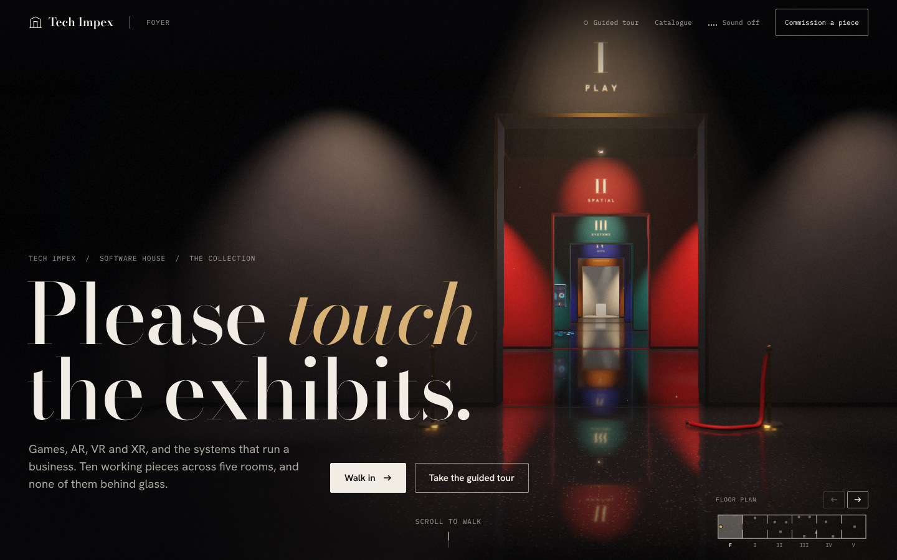
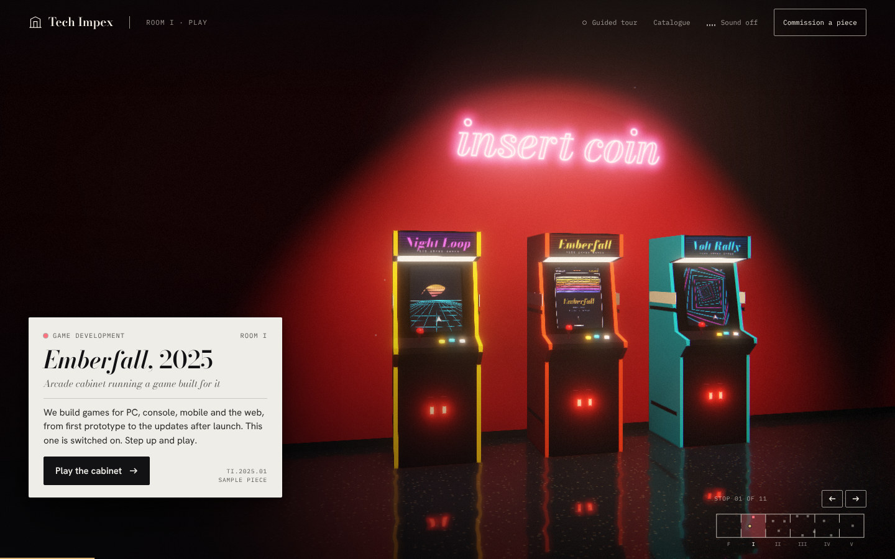
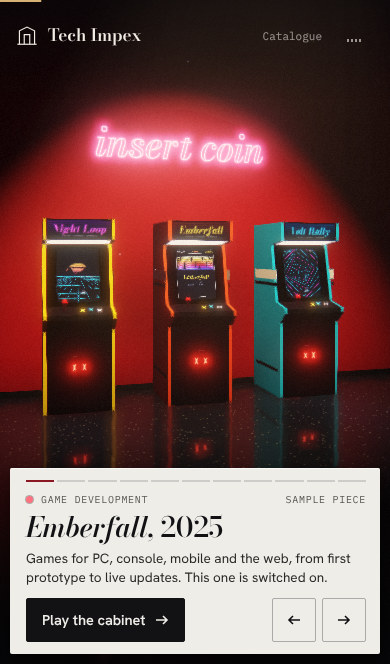

# Tech Impex: The Collection

"Please touch the exhibits." A website concept for a software house, set in a museum at night. Scrolling walks you through six rooms in a straight line, so from the entrance you can see every doorway nested inside the last. Each of the ten things the studio builds is an exhibit with a wall label, and every exhibit does something.



| Room | Exhibit (sample name) | Capability | What you can do |
|---|---|---|---|
| I Play | Emberfall, an arcade cabinet | Game development | Play a brick-breaker on the cabinet screen, with score, levels, lives and a saved high score |
| II Spatial | Roomline, a hologram plinth | Augmented reality | Swap between four furniture holograms and drag to turn them |
| II Spatial | Deepshift, a headset in a glass case | Virtual reality | Put the headset on and find three beacons by looking at them |
| II Spatial | Halo Room, floating panels | Mixed reality (XR) | Touch a panel to bring it forward |
| III Systems | Meridian | Internal management systems | Opens a live operations system |
| III Systems | Kestrel | CRM | Opens the same system at its sales pipeline, where deals can be moved to Won |
| III Systems | Northstar | Sales management | Opens the same system at its analytics |
| III Systems | Pulse Board | Data analytics dashboards | Run the pointer across a 4.5 metre dashboard |
| IV Apps | Tandem, a 2.7 metre phone | Mobile apps | Tap through three app screens |
| IV Apps | Ledgerly | Web apps | Ripples when touched |
| V Commission | An empty plinth | Contact | "This plinth is empty." |



There is also a floor plan with previous and next buttons, a guided tour that walks the building by itself, a catalogue that lists all ten pieces, and a sound toggle.

## One file for every screen



On an upright phone each piece is framed whole in the top of the screen and its label becomes a card at the bottom, with previous and next under the thumb. A swipe that stops between two pieces carries on to the nearest one. The live system turns into a phone app: tabs across the top, stages that swipe sideways, tap a deal to move it on. A phone on its side and tablets keep the desktop arrangement.

## What is in this repo

| Path | What it is |
|---|---|
| `index.html` | The site. One file, ready to open or host. |
| `src/` | Sources |
| `build.cjs` | Rebuilds `index.html` from the sources |
| `docs/` | Screenshots used on this page |

## Open it

Open `index.html` in a browser. There is nothing to install. It needs an internet connection for three.js (from cdnjs) and the fonts (from Google Fonts).

It is a single static file, so any static host will serve it.

## Change it

Edit the files in `src/`, then rebuild:

```
node build.cjs
```

The scripts in `src/js/` are joined in file name order into one script, so they share one scope and the numbers in the names set the load order. `body.html` is the page markup and `style.css` the styles. The build needs Node and nothing else.

| Script | What it holds |
|---|---|
| `00-util.js` | Helpers, the studio name, scroll locking |
| `10-glsl.js` | Every shader |
| `30-screens.js`, `35-data.js` | The live screens drawn on the exhibits, and the capability and project lists |
| `40-engine.js` | The renderer: lighting, floor reflection, bloom, quality control |
| `50-scene.js`, `60-exhibits.js` | The rooms and the exhibits |
| `70-walk.js` | The scroll-driven walk, camera framing, wall labels |
| `75-demo.js` | The live sales and operations system |
| `85-ui.js`, `90-main.js` | Sound, cursor, floor plan, catalogue, start-up and the frame loop |

## Placeholder content to replace

Everything shown is sample content.

- **Studio name:** `STUDIO` at the top of `src/js/00-util.js`.
- **Exhibit names and label text:** the `EXH` list in `src/js/70-walk.js` (`body` is the desktop wording, `bodyN` the shorter phone wording).
- **Room names and wall colours:** the `ROOMS` list in `src/js/50-scene.js`.
- **Capabilities and projects:** the `CAPS` and `PROJ` lists in `src/js/35-data.js`.
- **Contact details:** the email, phone and city in `src/body.html` and `src/js/85-ui.js`.
- **Sales system demo data:** `src/js/75-demo.js`.

## Notes

- Built on three.js r128. Every lit surface uses one hand-written shader (six spotlights a room), and the floor reflection is the scene drawn a second time, mirrored. Fonts: Bodoni Moda, Hanken Grotesk, IBM Plex Mono.
- While loading it times a few frames and picks a quality level the graphics chip can hold. It steps down later only if frames are really slow on the GPU.
- If WebGL is missing or a shader fails it falls back to a plain page with the hero, contact details and catalogue.
- Sound is off until the visitor turns it on.
- AR and VR are simulated inside the page. There is no camera or headset access yet.
- Tested in a desktop browser engine at desktop, tablet and phone sizes (320 to 430 wide for phones, with touch events) using software rendering. It has not been tested on a physical phone yet.
